<!-- Generated by scripts/build_profile.py. Edit the script, then run it. -->

<picture><source media="(prefers-color-scheme: dark)" srcset="assets/hero-dark.svg"></picture>

**I'm a mobile engineer who ships on both Android and iOS, and I do my best work where an app has to hold up in the real world:** on slow networks, through long sessions, and as features pile up. I've been doing this at [Simform](https://www.simform.com/) since 2023, where I now own a production Android codebase end to end.

### What I bring to a team

- **Ownership of a whole app.** I own a production Android codebase end to end, both maintenance and new features, and I'm the person the team comes to when something is stuck.
- **Zero to MVP, fast.** I built a health-scanning Android app from scratch in two months: Jetpack Compose, real-time camera scanning with CameraX, and on-device ML with TensorFlow Lite. On another product, I was part of a 30-day push that took an MVP to the Play Store on deadline.
- **The migrations and clean-ups nobody wants.** As the solo developer, I brought a legacy Android app up to Android 15 and 16 KB page sizes, resolving 500+ issues. On another app, I fixed 70+ issues in two months to bring it level with its iOS version.
- **One engineer, both platforms.** Kotlin and Compose day to day, plus production iOS work in Swift, SwiftUI and UIKit, including migrating complex UIKit table and collection screens to SwiftUI.
- **Quality you can measure.** I introduced unit testing on a production app: wrote 500+ tests, updated 800+, and added them to the PR pipeline, so large upgrades no longer broke things unnoticed. In my own app, Baseline Profiles cut startup from about 1 s to 0.4 s.
- **A multiplier for the team.** I get Product, Design, Backend and iOS aligned on missing user journeys and edge cases before development starts, so there's less rework. I'm mentoring a new teammate, and I've run sessions on AI-assisted engineering, AI on iOS, and AR on Android.

### Proof: bugs I've tracked down

<b>An iOS app crashed and lost data</b> when users switched between several forms

- **Cause:** strong reference cycles in table view cells kept every visited form alive in memory, and image loading held on to more than it needed.
- **Fix:** broke the cycles and corrected how images load and release, found with Xcode Instruments. The crash and the data loss it caused stopped.

<b>Video uploads arrived truncated or corrupted</b> on poor networks (iOS)

- **Cause:** recording configuration and encoding didn't match, and uploads weren't handled safely when the connection dropped.
- **Fix:** corrected the recording setup, encoding and upload handling, so media arrives intact on bad connections.

<b>Real-time camera scanning lost stability</b> while the on-device ML pipeline ran (Android)

- **Cause:** objects in the CameraX + TensorFlow Lite frame pipeline lived too long, and each frame did work it didn't need.
- **Fix:** tightened object lifecycles and removed the unnecessary computation, so scanning stayed stable in real time.

<b>Linked dropdowns swapped their values</b> inside nested, server-driven forms (iOS)

- **Cause:** the way the form fields were generated let state from one subform leak into another.
- **Fix:** isolated updates to the active subform, so each dropdown keeps its own value.

<b>App Links stopped verifying</b> during a domain migration (Android)

- **Cause:** the move to a new domain broke Android's App Links verification, so links stopped opening in the app.
- **Fix:** traced it to the root cause, documented it, and worked with the relevant teams to put the fix in place.

<b>Deferred deep links worked on one phone but not another</b> (Android)

- **Cause:** the device and the app interpreted the user agent differently.
- **Fix:** tracked the mismatch down together with the backend team.

### Shipped and open source

<a href="https://miraro.zettamask.com"><picture><source media="(prefers-color-scheme: dark)" srcset="assets/spot-miraro-dark.svg"></picture></a>
<a href="https://github.com/ankit-verma-209171/android-docs-mcp"><picture><source media="(prefers-color-scheme: dark)" srcset="assets/spot-android-docs-mcp-dark.svg"></picture></a>

| Project | What it shows |
| :--- | :--- |
| [**AR Treasure Hunt**](https://github.com/SimformSolutionsPvtLtd/SS-ARTreasureHunt) | Geospatial AR: 3D content anchored to real-world coordinates with ARCore and AR Foundation |
| [**ScribbleDash**](https://github.com/ankit-verma-209171/scribble-dash) | One codebase on Android and iOS: a sketching game in Compose Multiplatform |
| [**AniFlow**](https://github.com/ankit-verma-209171/AniFlow) | Offline-first architecture: Room cache synced through Paging 3 `RemoteMediator` |
| [**RustInteropDemo**](https://github.com/ankit-verma-209171/RustInteropDemo) | Native performance on Android: Kotlin calling Rust over JNI, raced against the JVM |
| [**Process death, explained**](https://github.com/ankit-verma-209171/android-process-death-recovery-demo) | State that survives: `remember` vs `rememberSaveable` vs `ViewModel` vs `SavedStateHandle` |

### Let's talk

If your app needs to ship on both platforms and stay solid as it grows, I'd like to hear about it.
[LinkedIn](https://www.linkedin.com/in/ankit-verma-209171/) · [Email](mailto:ankitverma209171@gmail.com) · [LeetCode](https://leetcode.com/u/ankit-verma-209171/)
