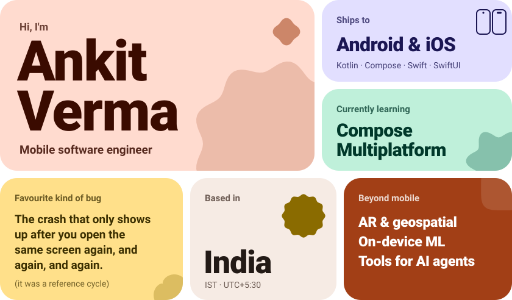
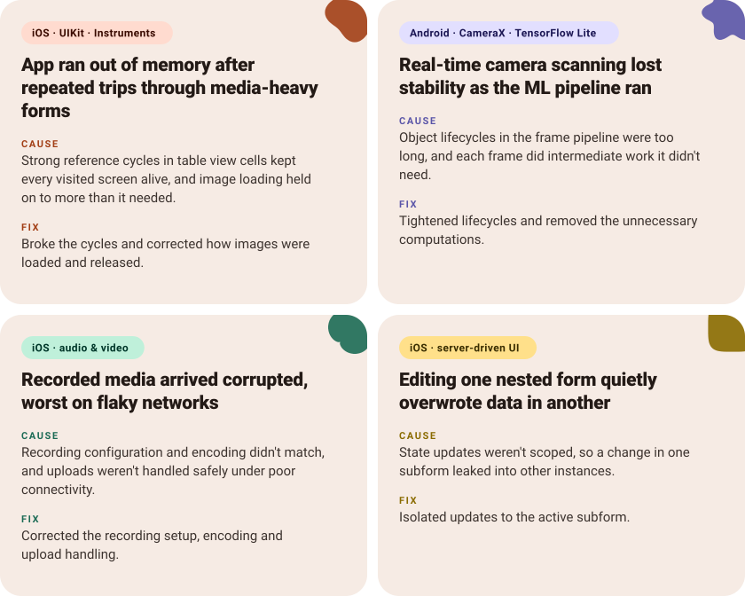
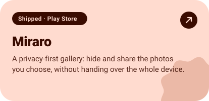
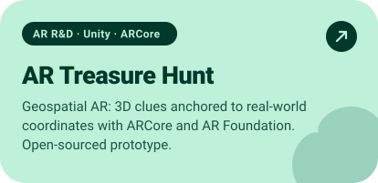
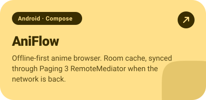
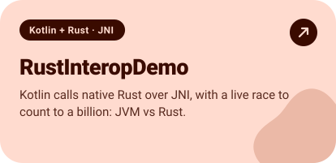
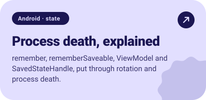
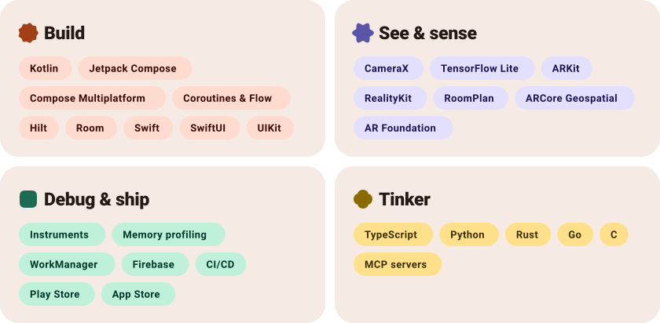

<!-- Generated by scripts/build_profile.py. Edit the script, then run it. -->

<picture><source media="(prefers-color-scheme: dark)" srcset="assets/hero-dark.svg"></picture>

I build mobile apps that don't just work, but keep working well as they grow. Most days that means Kotlin and Jetpack Compose; other days it's Swift in a production iOS codebase, an AR prototype, or a tool that helps AI agents read the Android docs. I like owning features end to end, and I like the bugs most people would rather not touch.

<picture><source media="(prefers-color-scheme: dark)" srcset="assets/heading-bugs-dark.svg"></picture>

<picture><source media="(prefers-color-scheme: dark)" srcset="assets/bugs-dark.svg"></picture>

<picture><source media="(prefers-color-scheme: dark)" srcset="assets/heading-built-dark.svg"></picture>

<a href="https://miraro.zettamask.com"><picture><source media="(prefers-color-scheme: dark)" srcset="assets/project-miraro-dark.svg"></picture></a>
<a href="https://github.com/ankit-verma-209171/android-docs-mcp"><picture><source media="(prefers-color-scheme: dark)" srcset="assets/project-android-docs-mcp-dark.svg"></picture></a>

<a href="https://github.com/SimformSolutionsPvtLtd/SS-ARTreasureHunt"><picture><source media="(prefers-color-scheme: dark)" srcset="assets/project-ar-treasure-hunt-dark.svg"></picture></a>
<a href="https://github.com/ankit-verma-209171/AniFlow"><picture><source media="(prefers-color-scheme: dark)" srcset="assets/project-aniflow-dark.svg"></picture></a>

<a href="https://github.com/ankit-verma-209171/RustInteropDemo"><picture><source media="(prefers-color-scheme: dark)" srcset="assets/project-rust-interop-dark.svg"></picture></a>
<a href="https://github.com/ankit-verma-209171/android-process-death-recovery-demo"><picture><source media="(prefers-color-scheme: dark)" srcset="assets/project-process-death-dark.svg"></picture></a>

<picture><source media="(prefers-color-scheme: dark)" srcset="assets/heading-toolbox-dark.svg"></picture>

<picture><source media="(prefers-color-scheme: dark)" srcset="assets/toolbox-dark.svg"></picture>

<picture><source media="(prefers-color-scheme: dark)" srcset="assets/heading-hello-dark.svg"></picture>

<a href="https://www.linkedin.com/in/ankit-verma-209171/"><picture><source media="(prefers-color-scheme: dark)" srcset="assets/contact-linkedin-dark.svg"></picture></a>
<a href="https://leetcode.com/u/ankit-verma-209171/"><picture><source media="(prefers-color-scheme: dark)" srcset="assets/contact-leetcode-dark.svg"></picture></a>
<a href="mailto:ankitverma209171@gmail.com"><picture><source media="(prefers-color-scheme: dark)" srcset="assets/contact-email-dark.svg"></picture></a>

<picture><source media="(prefers-color-scheme: dark)" srcset="assets/footer-dark.svg"></picture>
