<!-- Generated by scripts/build_profile.py. Edit the script, then run it. -->

<picture><source media="(prefers-color-scheme: dark)" srcset="assets/hero-dark.svg"></picture>

Throw me at anything: a new platform, a legacy codebase, a bug nobody can pin down. I start with a plan, work the problem down to its cause, and build something that stays stable. Mostly that means Android and iOS apps, which I've been building at [Simform](https://www.simform.com/) since 2023.

### What I've been doing

- **Owning a codebase.** After a teammate left, I took over a production Android app on a two-person team, from maintenance to new features.
- **From scratch to MVP.** A health-scanning Android app in two months, with real-time camera scanning and on-device ML.
- **Migrations and clean-ups.** 500+ issues resolved, solo, to bring a legacy browser to Android 15, and 70+ fixes in two months to bring another app level with its iOS version.
- **Both platforms.** Kotlin and Compose day to day, plus production iOS work in Swift, SwiftUI and UIKit.
- **Testing and performance.** Introduced unit tests on a production app (500+ written, 800+ updated) and put them in the PR pipeline. In my own app, Baseline Profiles cut startup from about 1 s to 0.4 s.
- **Working across teams.** I get Product, Design, Backend and iOS aligned before we build, and I'm mentoring a new teammate.

### How I work with AI

Claude Code, Codex and Copilot are part of my daily work. This is the loop I run with them:

<picture><source media="(prefers-color-scheme: dark)" srcset="assets/loop-dark.svg"></picture>

- **Features, start to finish.** Agents do much of the writing; I own the plan, the context and the review.
- **The setup around them.** Skills, rules, MCP servers, hooks and guardrails, tuned to the codebase. I build on Matt Pocock's skills and pstack.
- **Redesign.** A full app redesign, carried through the codebase with agents.
- **Sessions.** I've run sessions on AI-native engineering: the change in mindset, and running work in parallel.

### Problems I've worked through

<b>A legacy Mozilla-based browser had to run on Android 15</b>, with me as the only developer

- **The work:** followed Mozilla's libraries through their moves and renames, replaced the ones that had broken, and recompiled an unmaintained native library for 16 KB pages, without changing the behaviour those libraries gave the app.
- **Result:** 500+ issues resolved, and the app running on Android 15.

<b>An iOS app crashed and lost data</b> when users switched between forms

- **Cause:** strong reference cycles in table view cells, plus incorrect image loading.
- **Fix:** broke the cycles and corrected the image loading, found with Xcode Instruments.

<b>Recorded video arrived corrupted or cut short</b> on poor networks (iOS)

- **Cause:** problems in the recording configuration, the upload handling and the encoding.
- **Fix:** corrected all three, which made uploads more reliable.

<b>Deferred deep links worked on one phone but not another</b> (Android)

- **Cause:** the device and the app interpreted the user agent differently.
- **Outcome:** tracked the mismatch down together with the backend team.

### Shipped and open source

<a href="https://miraro.zettamask.com"><picture><source media="(prefers-color-scheme: dark)" srcset="assets/spot-miraro-dark.svg"></picture></a>
<a href="https://github.com/ankit-verma-209171/android-docs-mcp"><picture><source media="(prefers-color-scheme: dark)" srcset="assets/spot-android-docs-mcp-dark.svg"></picture></a>

| Project | What it shows |
| :--- | :--- |
| [**AR Treasure Hunt**](https://github.com/SimformSolutionsPvtLtd/SS-ARTreasureHunt) | Geospatial AR: 3D content anchored to real-world coordinates with ARCore and AR Foundation |
| [**ScribbleDash**](https://github.com/ankit-verma-209171/scribble-dash) | One codebase on Android and iOS: a sketching game in Compose Multiplatform |
| [**AniFlow**](https://github.com/ankit-verma-209171/AniFlow) | Offline-first architecture: Room cache synced through Paging 3 `RemoteMediator` |
| [**RustInteropDemo**](https://github.com/ankit-verma-209171/RustInteropDemo) | Native performance on Android: Kotlin calling Rust over JNI, raced against the JVM |
| [**Process death, explained**](https://github.com/ankit-verma-209171/android-process-death-recovery-demo) | State that survives: `remember` vs `rememberSaveable` vs `ViewModel` vs `SavedStateHandle` |

### Let's talk

If you're working on something interesting, I'd be glad to hear about it.
[LinkedIn](https://www.linkedin.com/in/ankit-verma-209171/) · [Email](mailto:ankitverma209171@gmail.com) · [LeetCode](https://leetcode.com/u/ankit-verma-209171/)
