<!-- Generated by scripts/build_profile.py. Edit the script, then run it. -->

<picture><source media="(prefers-color-scheme: dark)" srcset="assets/hero-dark.svg"></picture>

Throw me at anything: a new platform, a legacy codebase, a bug nobody can pin down. I start with a plan, work the problem down to its cause, and build something that stays stable. Mostly that means Android and iOS apps, which I've been building at [Simform](https://www.simform.com/) since 2023.

### What I've been doing

- **Owning a codebase.** When a teammate left, I stepped up to own a production Android codebase on a two-person team, handling both maintenance and new features. Teammates come to me when they're stuck on something technical.
- **From scratch to MVP.** I built a health-scanning Android app from scratch in two months: Jetpack Compose, real-time camera scanning with CameraX, and on-device ML with TensorFlow Lite. On another product, I was part of a 30-day push that took an MVP to the Play Store on deadline.
- **Migrations and clean-ups.** As the only developer, I brought a large legacy privacy browser up to Android 15 and 16 KB page sizes, resolving 500+ issues (the story is below). On a View-based social app for anime fans, I fixed 70+ issues in two months across stories, reels and AI chat, bringing it level with its iOS version while helping build new features.
- **Both platforms.** Kotlin and Compose day to day, plus production iOS work in Swift, SwiftUI and UIKit, including migrating complex UIKit table and collection screens to SwiftUI.
- **Testing and performance.** I introduced unit testing on a production app: wrote 500+ tests, updated 800+, and added them to the PR pipeline, where they guarded against regressions during large upgrades. In my own app, Baseline Profiles cut startup from about 1 s to 0.4 s.
- **Working across teams.** I get Product, Design, Backend and iOS aligned on missing user journeys and edge cases before development starts, so there's less rework. I'm mentoring a new teammate, and I've run sessions on AI on iOS and AR on Android.

### How I work with AI

Claude Code, Codex and Copilot are part of my daily work. This is the loop I run with them:

<picture><source media="(prefers-color-scheme: dark)" srcset="assets/loop-dark.svg"></picture>

- **Features, start to finish.** Agents do much of the writing; I own the plan, the context and the review.
- **Debugging.** Agents help me read unfamiliar code and test ideas quickly.
- **The setup around them.** Skills, rules, prompts, MCP servers, hooks and guardrails, tuned so agents follow the codebase's conventions. I build on Matt Pocock's skills and pstack.
- **Migrations.** A full app redesign, carried through the codebase with agents.
- **Sessions.** I've run sessions on AI-native engineering: the change in mindset, and running work in parallel.

### Problems I've worked through

<b>A legacy Mozilla-based privacy browser had to run on Android 15</b>, and I was the only developer on it

- **Starting point:** a very large, outdated codebase built on Mozilla's Android libraries, with a Redux-style architecture and a mix of Views and Compose.
- **What it took:**
  - following Mozilla's code as it moved from several repos into a monorepo, across two GitHub homes, and finally into mozilla-central
  - mapping Mozilla libraries and plugins that had broken or been removed to their newer replacements, along with the namespace, resource and string moves that came with them
  - porting the app to the upstream changes it needed to run on Android 15
  - recompiling an unmaintained third-party native library for 16 KB page sizes
  - improving the proxy handling, and the experience of switching between normal and proxy modes
- **The constraint:** modernise all of it without changing the default behaviour users got from those libraries.
- **Result:** 500+ issues resolved, and the app running on Android 15 with 16 KB page support.

<b>An iOS app crashed and lost data</b> when users switched between several forms

- **Cause:** strong reference cycles in table view cells, plus incorrect image-loading behaviour.
- **Fix:** broke the reference cycles and corrected the image loading, diagnosed with Xcode Instruments. That ended the crash and the data loss it caused.

<b>Recorded audio and video arrived corrupted or cut short</b> on unreliable networks (iOS)

- **Cause:** problems in three places: the recording configuration, the upload handling, and mismatched encoding.
- **Fix:** corrected all three, which resolved the corruption and made uploads more reliable.

<b>Real-time camera scanning hit performance and memory bottlenecks</b> in the on-device ML pipeline (Android)

- **Cause:** performance and memory bottlenecks in the CameraX + TensorFlow Lite pipeline: object lifecycles and unnecessary intermediate computations.
- **Fix:** optimised the object lifecycles and removed those computations, which improved runtime stability during real-time scanning.

<b>Linked dropdowns swapped their values</b> inside nested, server-driven forms (iOS)

- **Cause:** the way the form fields were generated let state from one subform leak into another.
- **Fix:** isolated updates to the active subform, so each dropdown keeps its own value.

<b>App Links stopped verifying</b> during a domain migration (Android)

- **Cause:** Android's App Links verification failed after the move to a new domain.
- **Fix:** traced it to the root cause, documented it, and worked with the relevant teams to put the fix in place.

<b>Deferred deep links worked on one phone but not another</b> (Android)

- **Cause:** the device and the app interpreted the user agent differently.
- **Fix:** tracked the mismatch down together with the backend team.

### Shipped and open source

<a href="https://miraro.zettamask.com"><picture><source media="(prefers-color-scheme: dark)" srcset="assets/spot-miraro-dark.svg"></picture></a>
<a href="https://github.com/ankit-verma-209171/android-docs-mcp"><picture><source media="(prefers-color-scheme: dark)" srcset="assets/spot-android-docs-mcp-dark.svg"></picture></a>

| Project | What it shows |
| :--- | :--- |
| [**AR Treasure Hunt**](https://github.com/SimformSolutionsPvtLtd/SS-ARTreasureHunt) | Geospatial AR: 3D content anchored to real-world coordinates with ARCore and AR Foundation |
| [**ScribbleDash**](https://github.com/ankit-verma-209171/scribble-dash) | One codebase on Android and iOS: a sketching game in Compose Multiplatform |
| [**AniFlow**](https://github.com/ankit-verma-209171/AniFlow) | Offline-first architecture: Room cache synced through Paging 3 `RemoteMediator` |
| [**RustInteropDemo**](https://github.com/ankit-verma-209171/RustInteropDemo) | Native performance on Android: Kotlin calling Rust over JNI, raced against the JVM |
| [**Process death, explained**](https://github.com/ankit-verma-209171/android-process-death-recovery-demo) | State that survives: `remember` vs `rememberSaveable` vs `ViewModel` vs `SavedStateHandle` |

### Let's talk

If you're working on something interesting, I'd be glad to hear about it.
[LinkedIn](https://www.linkedin.com/in/ankit-verma-209171/) · [Email](mailto:ankitverma209171@gmail.com) · [LeetCode](https://leetcode.com/u/ankit-verma-209171/)
